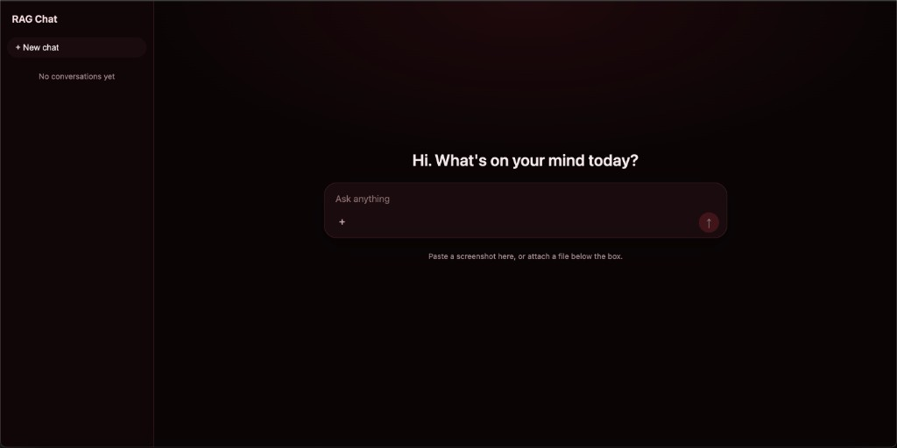
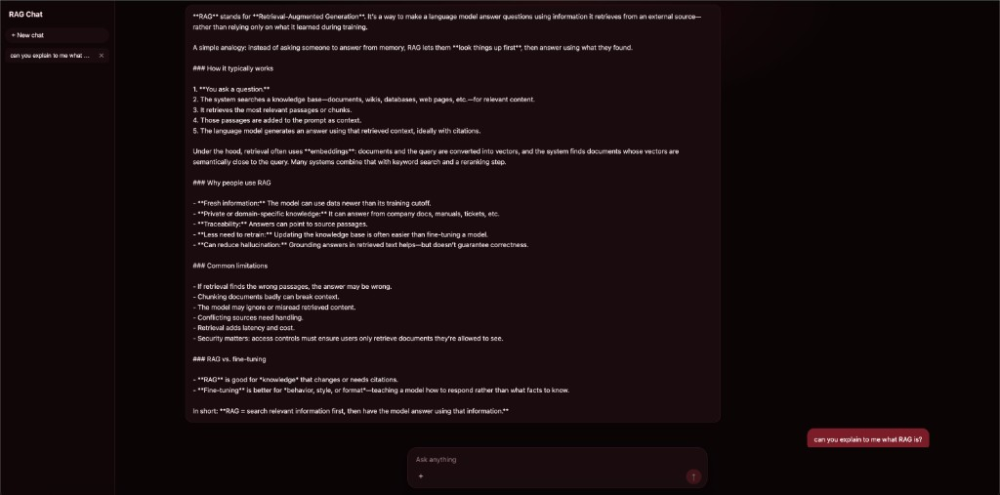

# Document-Grounded RAG Chatbot

[](https://react.dev/)
[](https://www.typescriptlang.org/)
[](https://fastapi.tiangolo.com/)
[](https://www.docker.com/)
[](https://github.com/pgvector/pgvector)
[](https://www.deepseek.com/)

Upload a document or screenshot, ask questions in plain language, and get answers grounded in **your** file — not generic web knowledge. Run locally with Docker, or deploy to AWS.

## Table of Contents

- [Features](#features)
- [Tech & Keywords](#tech--keywords)
- [Contributors](#contributors)
- [Overview](#overview)
- [Visuals & Demos](#visuals--demos)
- [Installation & Usage](#installation--usage)
- [Outcome](#outcome)
- [Reflections](#reflections)
- [Next Steps](#next-steps)
- [License](#license)
- [Citations](#citations)

## Features

- Conversation sidebar (create, switch, and delete chats)
- File upload **and** screenshot paste (PDF, TXT, MD, PNG, JPG, WEBP, GIF)
- OCR for images via Tesseract
- Document-scoped retrieval so “summarize this” uses the current attachment
- One-command local run with Docker Compose
- Optional AWS deploy with CDK (ECR / ECS Fargate)

## Tech & Keywords

`React` · `TypeScript` · `Vite` · `FastAPI` · `LangChain` · `PostgreSQL` · `pgvector` · `HuggingFace embeddings` · `Tesseract OCR` · `DeepSeek` · `Docker Compose` · `AWS CDK` · `ECS Fargate`

## Contributors

| Name | Role |
| ---- | ---- |
| Keshav Patel | Solo project — UI, RAG pipeline, Docker packaging, and AWS infrastructure |

## Overview

This project is a chat app that can **read a file you give it** and answer questions about that file.

In simple terms:

1. You open the app and start a chat.
2. You paste a screenshot or upload a PDF / text file.
3. You ask a question (for example, “summarize this”).
4. The app finds relevant pieces of your document, then asks an AI model to answer using those pieces.
5. Follow-up questions keep using the same document until you attach a new one.

Under the hood it uses a **RAG** (retrieval-augmented generation) pipeline: embeddings in Postgres/pgvector, OCR for images, and DeepSeek for generation. The goal is a portfolio-ready fullstack demo that feels like a real product, not a one-off notebook.

## Visuals & Demos

### Walkthrough video

https://github.com/user-attachments/assets/86da2b97-ec95-458a-9b34-9093012d59b9

*Caption: ~2 min walkthrough with voiceover — attach a document, ask questions, and see follow-ups stay scoped to that file.*

### Empty chat — first impression



*Caption: Home screen. Sidebar for conversations, greeting in the main pane, and a compose box that accepts typed questions or pasted screenshots.*

### Live conversation



*Caption: A saved chat asking “can you explain to me what RAG is?” The assistant replies in structured Markdown; the sidebar shows conversation history.*

### Architecture (local)

```
Browser
  → Frontend (React / Vite / nginx)     :5173
  → Backend  (FastAPI / LangChain)      :8000
       → Postgres + pgvector            :5432
            • chat history (SQLAlchemy)
            • document chunks + embeddings (PGVector)
       → DeepSeek API (LLM)
```

| Path | Responsibility |
| ---- | -------------- |
| `frontend/` | Chat UI |
| `backend/` | REST API, OCR, RAG, DeepSeek |
| `infra/` | AWS CDK stack + deploy scripts |
| `docker-compose.yml` | Local full stack |

## Installation & Usage

### Prerequisites

- [Docker Desktop](https://www.docker.com/products/docker-desktop/)
- A [DeepSeek API key](https://platform.deepseek.com/)
- (Optional, for AWS) AWS CLI

### How to install and run (local)

```bash
git clone https://github.com/Kpatel1013/RAG-Chatbot-Fullstack.git
cd RAG-Chatbot-Fullstack

cp backend/.env.example backend/.env
cp frontend/.env.example frontend/.env
```

Edit `backend/.env` and set:

```env
DEEPSEEK_API_KEY=your_key_here
DEEPSEEK_MODEL=deepseek-flash
```

Start everything:

```bash
docker compose up --build
```

Then open:

- App: [http://localhost:5173](http://localhost:5173)
- API health: [http://localhost:8000/health](http://localhost:8000/health)
- API docs: [http://localhost:8000/docs](http://localhost:8000/docs)

First backend build can take several minutes (embedding model download).

### How to use

1. Paste a screenshot or upload a PDF / `.txt`.
2. Ask something about that file (e.g. “summarize this”).
3. Ask a follow-up without re-attaching — it keeps using the same document.
4. Attach a new file to switch context, or delete chats from the sidebar.

Stop the stack with `Ctrl+C` or:

```bash
docker compose stop
```

### Environment variables

**Backend (`backend/.env`)**

| Variable | Purpose |
| -------- | ------- |
| `DATABASE_URL` | Postgres URL (Compose overrides this to use the `db` service) |
| `DEEPSEEK_API_KEY` | Required for chat |
| `DEEPSEEK_API_BASE` | Default `https://api.deepseek.com` |
| `DEEPSEEK_MODEL` | e.g. `deepseek-flash` |
| `EMBEDDING_MODEL` | Default `sentence-transformers/all-MiniLM-L6-v2` |
| `CORS_ORIGINS` | Comma-separated allowed origins |

`backend/.env` is gitignored. Commit only `backend/.env.example`.

**Frontend (`frontend/.env`)**

| Variable | Purpose |
| -------- | ------- |
| `VITE_API_URL` | Backend base URL (default `http://localhost:8000`) |

### API overview

| Method | Path | Description |
| ------ | ---- | ----------- |
| `GET` | `/health` | Liveness check |
| `POST` | `/api/upload` | Ingest a file; returns `doc_id` |
| `POST` | `/api/chat` | Send a message (optional `conversation_id`, `doc_id`) |
| `GET` | `/api/conversations` | List chats |
| `GET` | `/api/conversations/{id}/messages` | Load messages |
| `DELETE` | `/api/conversations/{id}` | Delete a chat |

### Deploy to AWS (optional)

```bash
cd infra
python3 -m venv .venv
source .venv/bin/activate   # Windows: .venv\Scripts\activate
pip install -r requirements.txt

export DEEPSEEK_API_KEY='your_key_here'
./scripts/deploy.sh          # CDK bootstrap + deploy stack
./scripts/deploy-images.sh   # Build/push images, restart ECS
```

**Note:** This stack incurs AWS charges. Destroy the stack when you are done testing.

### Project structure

```
.
├── backend/           # FastAPI app, RAG pipeline, Dockerfile
├── frontend/          # React + TypeScript UI, nginx Dockerfile
├── infra/             # AWS CDK app + deploy scripts
├── docs/              # README screenshots + demo walkthrough video
├── docker-compose.yml # Local db + backend + frontend
└── README.md
```

## Outcome

- A runnable fullstack chatbot that grounds answers in an attached document
- Local demo path via Docker Compose and an optional AWS path via CDK
- UI patterns people recognize (sidebar chats, paste-to-attach, follow-ups)
- Safer retrieval behavior: new chats without an attachment do not pull old uploads

## Reflections

**Document scoping.** Early versions searched the whole vector store when no file was attached, so a “new chat” could still recall older uploads. Scoping retrieval to a `doc_id` (and skipping search when none exists) made the product feel trustworthy.

**OCR + text in one flow.** Supporting screenshots meant accepting imperfect OCR. The tradeoff was convenience for users versus noisier chunks; chunking and clear prompts help the model stay honest when context is thin.

**Docker-first, cloud-second.** Compose was the priority so anyone can try the app without AWS. CDK/ECS is there to show a production-shaped path, but local is the default story.

**Model choice.** DeepSeek’s OpenAI-compatible API kept the backend simple while staying cost-friendly for demos.

## Next Steps

Ideas for the future:

- Streaming responses in the UI
- Citation chips that jump back to the source chunk
- Auth and multi-user workspaces

**Call to action:** Feedback and ideas are welcome. Open a [GitHub issue](https://github.com/Kpatel1013/RAG-Chatbot-Fullstack/issues) on this repo, or connect on [LinkedIn](https://www.linkedin.com/in/keshavpatel13) if you’d like to discuss the design.

To conclude — thanks for reading. If you try the app locally, I’d love to hear what worked and what didn’t.

## License

Personal / portfolio project. All rights reserved unless a license file is added later.

## Citations

- [DeepSeek](https://www.deepseek.com/) — LLM API
- [LangChain](https://www.langchain.com/) — RAG orchestration
- [pgvector](https://github.com/pgvector/pgvector) — vector similarity in Postgres
- [Hugging Face](https://huggingface.co/) — embedding model (`sentence-transformers/all-MiniLM-L6-v2`)
- [Tesseract OCR](https://github.com/tesseract-ocr/tesseract) — image text extraction
- [FastAPI](https://fastapi.tiangolo.com/) · [React](https://react.dev/) · [Vite](https://vitejs.dev/) · [Docker](https://www.docker.com/) · [AWS CDK](https://aws.amazon.com/cdk/)
